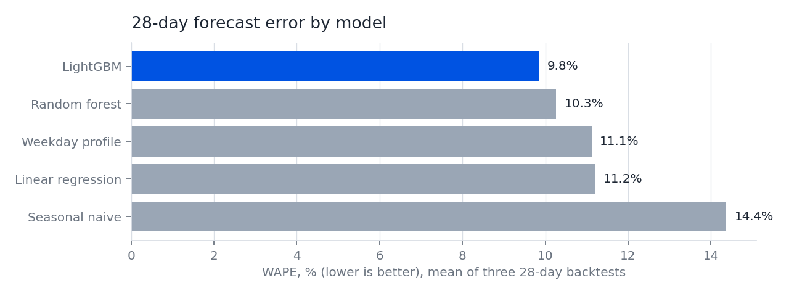
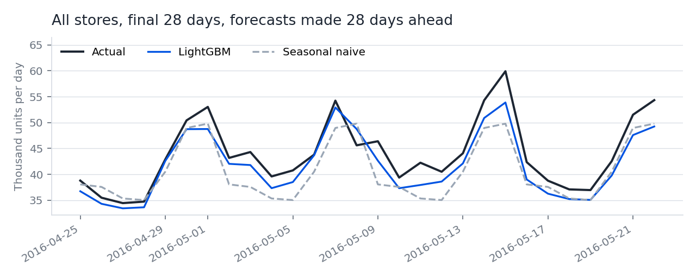
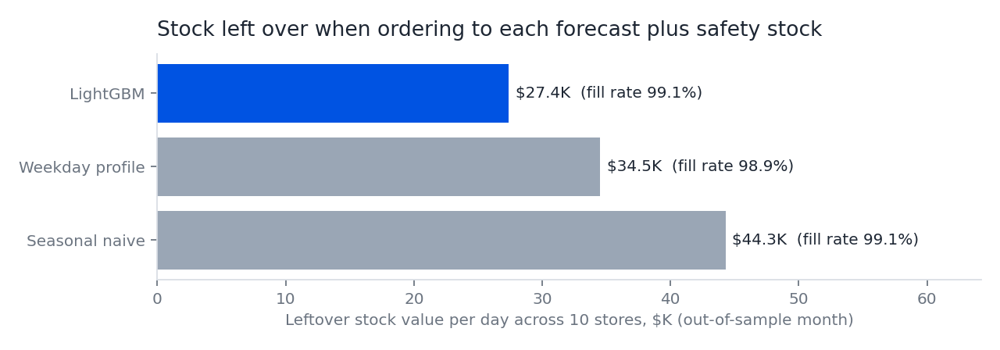
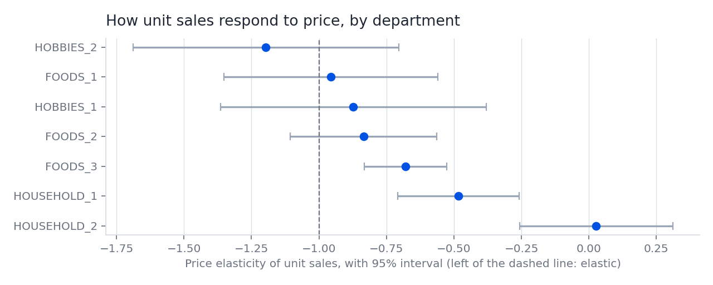
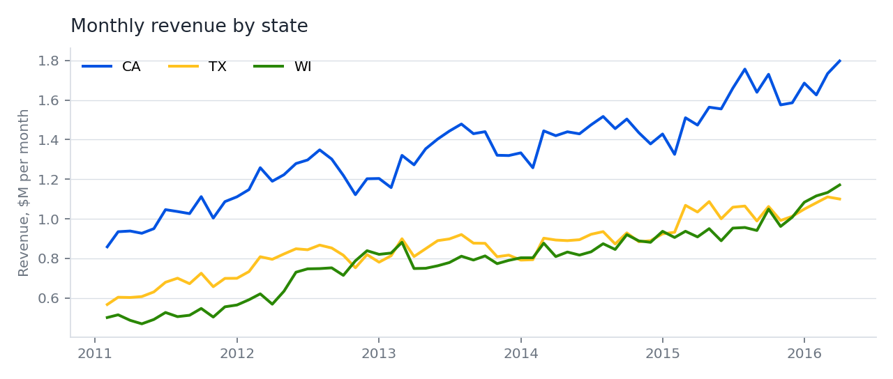

# Walmart sales, forecasting and pricing analytics

An end-to-end retail analytics project on Walmart's own store-item data: a DuckDB
warehouse of 46.9 million sales rows, SQL revenue marts, 28-day demand forecasts
backtested against baselines, a safety-stock test of what better forecasts are worth,
and price elasticity by department.

Every number below is produced by `walmart-analytics all` and written to
[`reports/results.json`](reports/results.json); full tables are in
[`reports/RESULTS.md`](reports/RESULTS.md).

## Findings

**Forecasting.** A LightGBM model forecasts daily unit sales for all 70 store-department
series 28 days ahead with **90.1% accuracy** (WAPE 9.85%, averaged over three rolling
28-day backtests). That is **31% less error than a seasonal-naive forecast** and 11% less
than a weekday-profile baseline. Random forest (10.3%) and linear regression (11.2%) were
also tested.




**Inventory.** Ordering to each forecast plus a 95% safety buffer calibrated on earlier
months, then tested on a month the models never saw: the LightGBM forecast keeps the same
**99.1% unit fill rate** as the naive forecast with **37% less safety stock** and **38% less
leftover stock** ($27.4K against $44.3K of stock value per day across the 10 stores).



**Pricing and profitability.** Demand in the three departments that make **68% of revenue**
(FOODS_3, HOUSEHOLD_1, HOUSEHOLD_2) is clearly inelastic. A 10% price cut is estimated to
raise units by less than 8% and lower revenue by 3% to 10%. Because more units are sold for
less money, the cut lowers gross profit whatever the unit cost, so markdowns in these
departments need a reason other than volume, such as clearing stock. Only HOBBIES_2 (under
1% of revenue) shows elastic demand.



**Revenue drivers** (SQL marts in [`sql/marts.sql`](src/walmart_analytics/sql/marts.sql)):

- $191.6M of revenue from January 2011 to May 2016; 2015 revenue was $42.4M, up 12% on 2014.
- FOODS is 58% of revenue, HOUSEHOLD 30%, HOBBIES 12%.
- 37% of item-store combinations make 80% of revenue.
- Saturdays and Sundays run about 21% above the average day; Tuesday to Thursday 12% to 13% below.
- On SNAP benefit days, FOODS revenue is 10% higher in California, 17% in Texas and 32% in
  Wisconsin than on other days of the same month.
- 60% of item-store-days sell nothing, which is why forecasts are made at store-department
  level, where demand is steady enough to plan stock against.



## Data

The [M5 dataset](https://www.kaggle.com/competitions/m5-forecasting-accuracy/data):
daily unit sales of 3,049 Walmart products in 10 stores across California, Texas and
Wisconsin, with weekly shelf prices and a calendar of holidays, sporting events and SNAP
days. Walmart released it for the M5 forecasting competition run by the University of
Nicosia. The data is not stored in this repository; `walmart-analytics download` fetches it
from [Nixtla's public mirror](https://github.com/Nixtla/m5-forecasts).

The data has prices but no costs, so the project reports revenue and stock value, not
margin. The profitability finding above holds for any unit cost.

## How it works

| Step | Module | What it does |
| --- | --- | --- |
| Load | [`data.py`](src/walmart_analytics/data.py) | Unpivots the wide daily file into one row per item, store and day; joins the calendar and that week's shelf price to get revenue; drops days before an item was on the shelf. |
| Revenue marts | [`marts.sql`](src/walmart_analytics/sql/marts.sql) | Named DuckDB queries: revenue by year, month and state, category and department mix, store scorecard, concentration, weekday index, SNAP effect. |
| Forecast | [`forecast.py`](src/walmart_analytics/forecast.py) | Features that are all at least 28 days old at prediction time (lags, rolling means, price index, calendar, SNAP, events). Five models scored with a rolling-origin backtest. |
| Inventory | [`inventory.py`](src/walmart_analytics/inventory.py) | Calibrates a safety buffer per series on earlier folds from each model's errors and tests the resulting stock policy on the final month. |
| Pricing | [`pricing.py`](src/walmart_analytics/pricing.py) | Log-log elasticity with item-store and store-department-week fixed effects, removed by alternating demeaning; standard errors clustered by item-store. |
| Report | [`report.py`](src/walmart_analytics/report.py) | Figures, `results.json` and `RESULTS.md`. |

## Run it

```bash
pip install -e ".[dev]"
walmart-analytics all     # download (~50 MB), build the warehouse, run everything (~5 min)
pytest                    # tests run on a small synthetic dataset, no download needed
```

## Limits

- Ten stores and about 3,000 products are a sample of Walmart, not the whole chain.
- Elasticities come from shelf price changes. Advertised promotions, displays and
  competitor prices are not in the data, so the estimates are associations controlled for
  item, store, department and week, not experiments.
- The inventory test assumes daily ordering to the forecast with no lead time or case packs.

## Stack

Python, SQL, DuckDB, pandas, scikit-learn, LightGBM, matplotlib, pytest, GitHub Actions.
